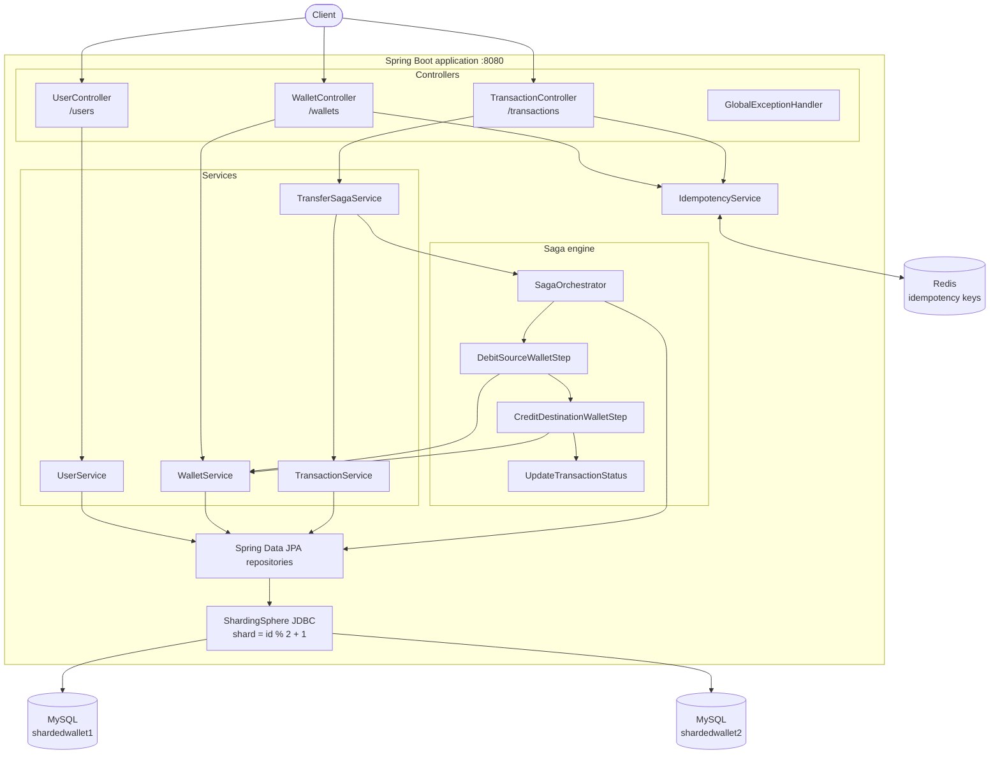
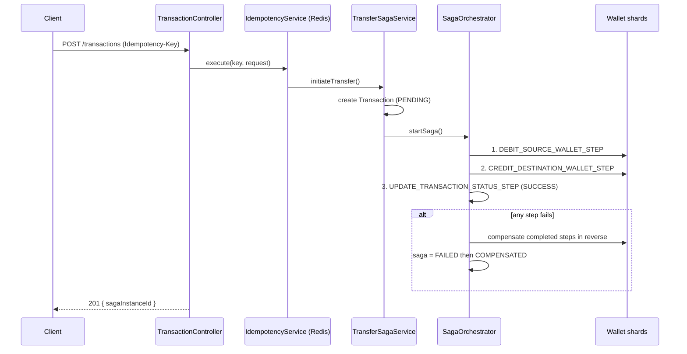

# Sharded Wallet

A wallet service built with Spring Boot 3 (Java 21). Data is horizontally sharded across two MySQL databases with Apache ShardingSphere, money transfers run as an orchestrated saga with compensation, and write endpoints are idempotent through Redis.

## Architecture



### Sharding

`user`, `wallet`, `transaction`, `saga_instance` and `saga_step` are sharded by `id` using the inline expression `shardedwallet${id % 2 + 1}`. IDs are generated by ShardingSphere's Snowflake generator, so they are 64-bit and globally unique. A transfer between two wallets can therefore touch two different databases, which is why it is modelled as a saga rather than a single DB transaction.

### Transfer saga



Statuses:

| Entity | Values |
|---|---|
| Saga | `STARTED`, `RUNNING`, `COMPLETED`, `FAILED`, `COMPENSATING`, `COMPENSATED` |
| Saga step | `PENDING`, `RUNNING`, `COMPLETED`, `FAILED`, `COMPENSATING`, `COMPENSATED`, `SKIPPED` |
| Transaction | `PENDING`, `SUCCESS`, `FAILED`, `CANCELLED` |

### Idempotency

`POST /wallets/{id}/debit`, `POST /wallets/{id}/credit` and `POST /transactions` require an `Idempotency-Key` header. State is stored in Redis under `idempotency:<scope>:<key>`.

- First request: the key is claimed as `IN_PROGRESS` (60 s TTL), the action runs, and the response is stored for 24 h.
- Retry with the same key and body: the stored response is replayed with the header `Idempotent-Replayed: true`. The action does not run again.
- Retry while the first request is still running: `409 Conflict`.
- Same key with a different body: `422 Unprocessable Entity`.
- If the action throws or returns a 5xx, the key is released so the client can retry.

## Running with Docker

Prerequisites: Docker with Compose.

```bash
cp .env.example .env
cp src/main/resources/application.example.properties src/main/resources/application.properties
cp src/main/resources/sharding.example.yml src/main/resources/sharding.yml
# edit .env and set DB_PASSWORD

docker compose up --build -d
```

This starts MySQL 8.4 (with `shardedwallet1` and `shardedwallet2` created), Redis 7 and the app on `http://localhost:8080`. The app image is built in three stages: Gradle build, Spring Boot layer extraction, and a slim JRE runtime running as a non-root user.

Stop with `docker compose down`; add `-v` to also delete the database and Redis volumes.

### Configuration

`application.properties`, `sharding.yml` and `.env` are git-ignored. Use the committed `*.example` files as templates.

| Variable | Default | Purpose |
|---|---|---|
| `DB_HOST` | `localhost` | MySQL host |
| `DB_PORT` | `3306` | MySQL port |
| `DB_USERNAME` | `root` | MySQL user |
| `DB_PASSWORD` | none (required by Compose) | MySQL password |
| `SPRING_DATA_REDIS_HOST` | `localhost` | Redis host |
| `SPRING_DATA_REDIS_PORT` | `6379` | Redis port |

### Running locally without Docker

Start MySQL (create `shardedwallet1` and `shardedwallet2`) and Redis, set `DB_PASSWORD` in the environment, then:

```bash
./gradlew bootRun
```

`spring.jpa.hibernate.ddl-auto=create` drops and recreates tables on every start. Change it to `update` if you want to keep data across restarts.

## API reference

Base URL: `http://localhost:8080`. All bodies are JSON. IDs are 64-bit snowflake values; send them as numbers.

Errors from `GlobalExceptionHandler` have the shape `{ "error": "<message>" }`:
`NoSuchElementException` returns `404`, `IllegalArgumentException` returns `400`.

### Users

#### `POST /users`

Create a user.

Request:

```json
{ "name": "Alice", "email": "alice@example.com" }
```

Response `201 Created`:

```json
{ "id": 1316905060340334592, "name": "Alice", "email": "alice@example.com" }
```

#### `GET /users/{id}`

Get a user by ID. Returns `200` with the user, or `404` if it does not exist.

#### `GET /users/name?name={name}`

List users with the exact given name. Returns `200` with an array, empty if none match.

### Wallets

#### `POST /wallets`

Create an active wallet with a zero balance for a user.

Request:

```json
{ "userId": 1316905060340334592 }
```

Response `201 Created`:

```json
{ "id": 1316905116724363264, "userId": 1316905060340334592, "isActive": true, "balance": 0 }
```

Returns `500` if creation fails.

#### `GET /wallets/{id}`

Get a wallet. Returns `200` with the wallet, or `404` with `{"error":"Wallet not found"}`.

#### `GET /wallets/{id}/balance`

Get the balance. Returns `200` with a bare number, for example `380.00`.

#### `POST /wallets/{id}/credit`

Add funds. Requires the `Idempotency-Key` header.

Request:

```json
{ "amount": 500 }
```

Response `200 OK`: the updated wallet.

#### `POST /wallets/{id}/debit`

Remove funds. Requires the `Idempotency-Key` header.

Request:

```json
{ "amount": 100 }
```

Response `200 OK`: the updated wallet. Returns `400` with `{"error":"Insufficient balance"}` if the balance is too low, or `404` if the wallet does not exist.

### Transactions

#### `POST /transactions`

Transfer money between two wallets using the saga. Requires the `Idempotency-Key` header.

Request:

```json
{
  "fromWalletId": 1316905116724363264,
  "toWalletId": 1316905116992798721,
  "amount": 120,
  "description": "rent"
}
```

Response `201 Created`:

```json
{ "sagaInstanceId": 1316905120411156481 }
```

The transfer runs synchronously before the response returns. A `201` means the saga was created and run, not that the transfer succeeded: if a step fails (for example insufficient balance), completed steps are compensated and the saga ends as `COMPENSATED`. Check the balances to confirm the outcome. Returns `500` on unexpected errors.

### Common idempotency responses

| Status | Meaning |
|---|---|
| `409` | Another request with this key is still in progress |
| `422` | The key was already used with a different request body |
| Replayed `2xx`/`4xx` | Same key and body; stored response returned with `Idempotent-Replayed: true` |

### Example session

```bash
B=http://localhost:8080; H='Content-Type: application/json'

curl -X POST $B/users   -H "$H" -d '{"name":"Alice","email":"alice@example.com"}'
curl -X POST $B/users   -H "$H" -d '{"name":"Bob","email":"bob@example.com"}'
curl -X POST $B/wallets -H "$H" -d '{"userId":<ALICE_ID>}'
curl -X POST $B/wallets -H "$H" -d '{"userId":<BOB_ID>}'

curl -X POST $B/wallets/<ALICE_WALLET>/credit -H "$H" -H 'Idempotency-Key: k1' -d '{"amount":500}'
curl -X POST $B/transactions -H "$H" -H 'Idempotency-Key: t1' \
  -d '{"fromWalletId":<ALICE_WALLET>,"toWalletId":<BOB_WALLET>,"amount":120,"description":"test"}'
curl $B/wallets/<ALICE_WALLET>/balance
```

## Project layout

```
src/main/java/com/example/sharded_wallet21/
  config/        saga step registration
  controllers/   REST endpoints and global exception handler
  dtos/          request/response bodies
  entities/      User, Wallet, Transaction, SagaInstance, SagaStep and status enums
  repositories/  Spring Data JPA repositories
  services/      business logic, idempotency, transfer saga
    saga/        orchestrator and steps
docker/          MySQL image and init script
```
